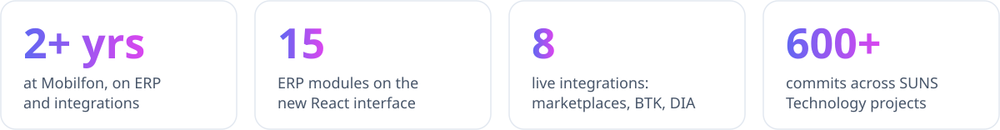
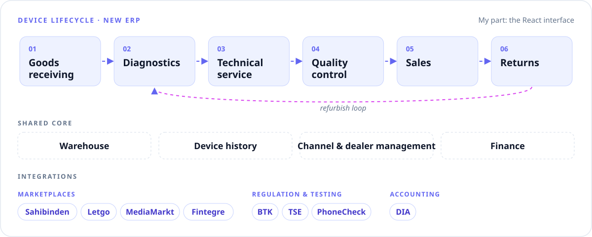
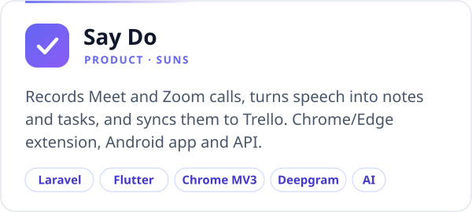
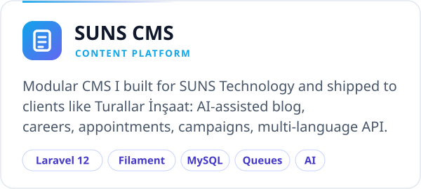
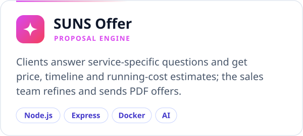
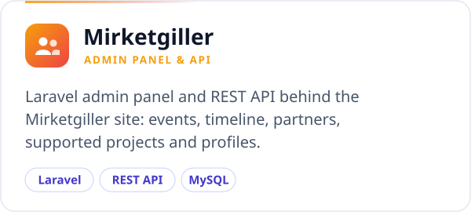
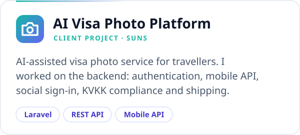
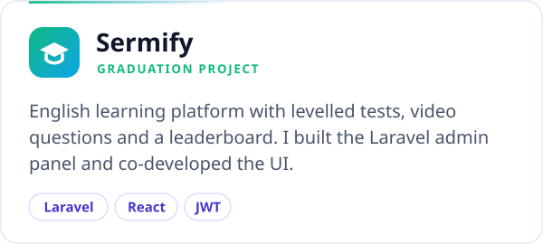

<picture><source media="(prefers-color-scheme: dark)" srcset="assets/header-dark.svg"></picture>

<picture><source media="(prefers-color-scheme: dark)" srcset="assets/stats-dark.svg"></picture>

## About

- **Now** · Full Stack Developer at **Mobilfon** since 2024, building the React interface of a new ERP for refurbished phones and the integrations it runs on
- **Operations** · Panels behind the Senkrona trade-in platform, Sahibinden Buyback, Letgo and on-site refurbishment, plus the public IMEI certificate & warranty check
- **Building** · Co-founder of **SUNS Technology**: our modular CMS, the proposal engine, Say Do, client projects, AI features and n8n automations
- **Also** · Requirement analysis with departments, onboarding new teammates; certified vocational trainer (Usta Öğreticilik Belgesi)

## What I'm Building at Mobilfon

<picture><source media="(prefers-color-scheme: dark)" srcset="assets/erp-dark.svg"></picture>

## Featured Work

  <a href="https://saydo.sunstech.com.tr"><picture><source media="(prefers-color-scheme: dark)" srcset="assets/card-say-do-dark.svg"></picture></a>
  <picture><source media="(prefers-color-scheme: dark)" srcset="assets/card-suns-cms-dark.svg"></picture>

  <a href="https://offer.sunstech.com.tr"><picture><source media="(prefers-color-scheme: dark)" srcset="assets/card-suns-offer-dark.svg"></picture></a>
  <picture><source media="(prefers-color-scheme: dark)" srcset="assets/card-mirketgiller-dark.svg"></picture>

  <picture><source media="(prefers-color-scheme: dark)" srcset="assets/card-ai-visa-photo-dark.svg"></picture>
  <a href="https://github.com/semaermin/BitirmeProjesiWeb"><picture><source media="(prefers-color-scheme: dark)" srcset="assets/card-sermify-dark.svg"></picture></a>

Most of my professional work lives in private company repositories.

## Tech Stack

<b>DAILY</b>

  <picture><source media="(prefers-color-scheme: dark)" srcset="https://skillicons.dev/icons?i=react%2Cjs%2Cts%2Ctailwind%2Cvite%2Cphp%2Claravel%2Cmysql&amp;theme=dark"></picture> 
  <picture><source media="(prefers-color-scheme: dark)" srcset="https://skillicons.dev/icons?i=nodejs%2Cexpress%2Cflutter%2Cdocker%2Cgithubactions%2Clinux%2Cnginx%2Cpostman&amp;theme=dark"></picture>

<b>ALSO WORKED WITH</b>

  <picture><source media="(prefers-color-scheme: dark)" srcset="https://skillicons.dev/icons?i=nextjs%2Credux%2Cpostgres%2Cmongodb%2Cspring%2Cdotnet&amp;theme=dark"></picture>

<b>AI &amp; AUTOMATION</b>

  
  
  
  

<b>Full list</b>

 

| | |
| --- | --- |
| **Frontend** | React · JavaScript · TypeScript · Vite · Tailwind CSS · shadcn/ui (Radix) · React Hook Form + Zod · Framer Motion |
| **Backend** | PHP · Laravel 12 (Eloquent, Queues/Jobs, Sanctum, JWT, Socialite) · Filament v4 · Spatie packages (permission, media library, translatable, activity log, backup) · CodeIgniter · Node.js/Express |
| **Mobile & extensions** | Flutter (Android) · Chrome/Edge extensions (Manifest V3) |
| **Database & storage** | MySQL · S3/MinIO object storage |
| **Testing & quality** | PHPUnit (feature & unit) · PHPStan · Laravel Pint · Postman collections · API documentation |
| **DevOps** | Docker & Compose · GitHub Actions (CI, Slack notifications) · Linux · Nginx · Plesk/cPanel |
| **AI-assisted development** | Claude · Claude Code · Cursor |
| **AI & automation** | n8n workflows · AI image tagging & image processing · LLM APIs (Groq) · Deepgram speech-to-text · AI writing pipelines |
| **Integrations** | Sahibinden · Letgo · MediaMarkt · Fintegre · BTK · TSE · PhoneCheck · DIA · Trello · Google/Microsoft/Apple sign-in |
| **Also worked with** | Next.js · Redux · PostgreSQL · MongoDB · MSSQL · Java Spring · ASP.NET · jQuery · Swagger/OpenAPI |

## Journey

<picture><source media="(prefers-color-scheme: dark)" srcset="assets/journey-dark.svg"></picture>

## GitHub Activity

  <picture><source media="(prefers-color-scheme: dark)" srcset="https://streak-stats.demolab.com?user=semaermin&amp;border_radius=18&amp;date_format=M%20j%5B%2C%20Y%5D&amp;background=161B22&amp;border=30363D&amp;stroke=30363D&amp;ring=818CF8&amp;fire=E879F9&amp;currStreakNum=F8FAFC&amp;currStreakLabel=818CF8&amp;sideNums=F8FAFC&amp;sideLabels=CBD5E1&amp;dates=94A3B8"></picture>

<a href="mailto:sema.erminn@gmail.com"><picture><source media="(prefers-color-scheme: dark)" srcset="assets/footer-dark.svg"></picture></a>
